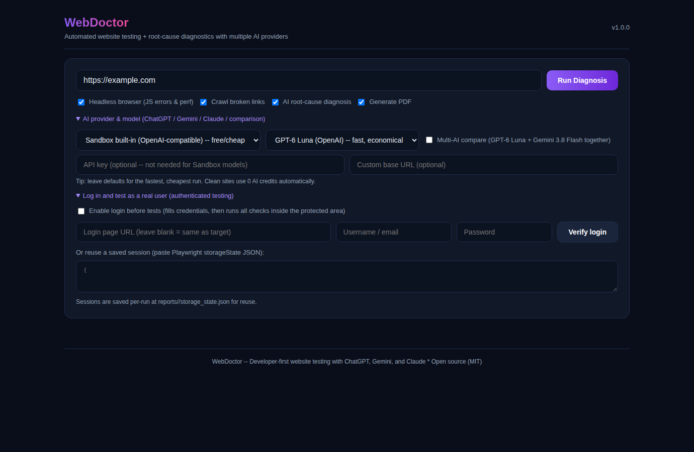

# WebDoctor

**Automated website testing and root-cause diagnostics for developers — with multiple AI providers (ChatGPT, Gemini, Claude) and authenticated/logged-in testing.**


---

## What WebDoctor tests

| Suite | Detects |
|---|---|
| **HTTP & SSL** | 4xx/5xx codes, response time, TTFB, redirect chains, SSL validation, gzip/brotli compression |
| **Security headers** | HSTS, CSP, X-Frame-Options, nosniff, Referrer-Policy, Permissions-Policy, insecure cookies |
| **SEO & accessibility** | Title/description, viewport, `lang`, missing `alt` on images, headings, favicon, form input labels |
| **Broken link crawler** | Concurrently checks every `<a>` and `` for 404s/5xxs/timeouts/SSL errors |
| **Real browser runtime** | Playwright Chromium: JS exceptions + stack traces, console errors, failed sub-resources, performance waterfall, screenshot |
| **Surveys & popups** | Auto-dismisses survey/feedback modals and cookie banners; inventories survey trackers; audits form/survey inputs |
| **Authentication** | Automated form login, session capture/reuse, auth-cookie security audit, post-login protected-area testing |
| **Diagnostics** | Every issue includes *"How it happened"*, a reproduction command, and a developer fix |

---

## 1. Multi-AI diagnosis (ChatGPT, Gemini, Claude, and more)

Choose your AI provider per run — or **compare multiple models side by side** in a single consensus report:

| Provider | Models | Setup |
|---|---|---|
| **Manus built-in (OpenAI-compatible)** | `gpt-6-luna`, `gpt-6.1-sol`, `gemini-3.8-flash`, `gpt-5-mini` | Available inside Manus-managed environments only |
| **OpenAI direct** | `gpt-5.5`, `gpt-4.1`, `gpt-4o`, `o3-mini` | Set `OPENAI_API_KEY` or `--ai-key` |
| **Anthropic Claude** | `claude-sonnet-4`, `claude-haiku-4`, `claude-opus-4` | Set `ANTHROPIC_API_KEY` or `--ai-key` |
| **Google Gemini direct** | `gemini-2.5-flash`, `gemini-2.5-pro` | Set `GEMINI_API_KEY` or `--ai-key` |

```bash
# List available models
webdoctor models

# Local/GitHub install: use a provider API key
export OPENAI_API_KEY="YOUR_OPENAI_API_KEY"
webdoctor check https://example.com --ai-provider openai --ai-model gpt-5.5

# Or use Claude
export ANTHROPIC_API_KEY="YOUR_ANTHROPIC_API_KEY"
webdoctor check https://example.com --ai-provider anthropic --ai-model claude-sonnet-4 --ai-key "$ANTHROPIC_API_KEY"

export GEMINI_API_KEY="YOUR_GEMINI_API_KEY"
webdoctor check https://example.com --ai-provider gemini --ai-model gemini-2.5-flash --ai-key "$GEMINI_API_KEY"

# Manus-managed environments only: built-in AI and comparison
webdoctor check https://example.com --ai-model gemini-3.8-flash
webdoctor check https://example.com --ai-compare sandbox:gpt-6-luna,sandbox:gemini-3.8-flash
```

When running a copy cloned from GitHub, configure a direct provider and its API key; the Manus built-in provider is not available outside Manus-managed environments. Use `--no-ai` for rule-based diagnostics without an AI key. Inside Manus, clean sites can skip the AI call automatically.

---

## 2. Authenticated / logged-in testing ("test like a real user")

WebDoctor can **log in with your account** and run all tests *inside the protected area* — so hidden pages (dashboards, survey panels, admin areas) get the same deep analysis:

### Method A — Web dashboard (easiest)

1. Open `http://localhost:8080`
2. Expand **"Log in and test as a real user"**
3. Enter your login URL, username, and password, then click **Verify login** to confirm credentials
4. Click **Run Diagnosis** — the report shows a green **LOGGED IN RUN** badge and scans the post-login pages

### Method B — CLI automated form login

```bash
webdoctor check "https://app.example.com/dashboard" \
  --login --login-url "https://app.example.com/login" \
  --username "you@company.com" --password "secret" --pdf
```

The browser fills and submits the form, audits the resulting session cookie, saves `storage_state.json`, and tests the protected area.

### Method C — Headful login for 2FA / SSO / OAuth (one time)

```bash
# A real browser opens -> you log in manually (SSO/2FA/captcha) -> press Enter -> session saved
webdoctor login "https://app.example.com/login" --save-session ./my-session.json

# Now reuse that session for unlimited authenticated tests
webdoctor check "https://app.example.com/dashboard" --session ./my-session.json --pdf
```

---

## Installation

```bash
git clone https://github.com/alrougi1/webdoctor.git
cd webdoctor
pip install -e .
playwright install chromium
```

---

## Quick start

```bash
# Free rule-based test
webdoctor check https://example.com --no-ai

# Full test with AI diagnosis + PDF
webdoctor check https://example.com --pdf

# CI/CD mode (exit code 0=pass / 1=fail)
webdoctor check https://example.com --no-ai --ci

# See all failure modes on the built-in broken demo site
webdoctor demo --pdf

# Launch the interactive web dashboard
webdoctor serve --port 8080
```

---

## Dashboard screenshots




---

## Reports

Every run can emit four reports (saved to `--report-dir`, default `./reports`):

| File | Purpose |
|---|---|
| `report.html` | Self-contained interactive report with embedded screenshots |
| `report.md` | One-page markdown — PR comments, CI summaries, Slack bots |
| `report.json` | Machine-readable results for dashboards and Datadog |
| `report.pdf` | Clean shareable PDF for stakeholders |
| `storage_state.json` | Saved login session for authenticated runs (reusable; keep private) |

**Important:** Reports and session files can contain private URLs, screenshots, and reusable authentication cookies. Never publish or share them. The repository ignores generated `reports/` by default; use a test account and protect session files like passwords.

---

## CI/CD integration

Copy [`examples/github_action.yml`](examples/github_action.yml) into `.github/workflows/webdoctor.yml`.

---

## Python SDK & pytest

```python
from webdoctor import run_diagnostics

report = run_diagnostics("https://example.com", browser_mode=True, check_links=True, ai=False)
assert report.score >= 80
assert report.metrics.get("js_error_count", 0) == 0
```

---

## Architecture

```
webdoctor/
├── webdoctor/
│   ├── models.py           # Issue, CheckResult, TestReport dataclasses + scoring
│   ├── config.py           # Timeouts, user-agent, AI models
│   ├── runner.py           # Suite orchestrator (anonymous + authenticated)
│   ├── cli.py              # CLI with rich terminal output
│   ├── checks/
│   │   ├── http_check.py   # HTTP status, TTFB, SSL, redirects, compression
│   │   ├── security.py     # Security headers & cookie flags
│   │   ├── browser.py      # Playwright: JS errors, console, perf, screenshots, popup dismisser
│   │   ├── links.py        # Concurrent broken link crawler
│   │   ├── seo_a11y.py     # SEO + a11y + form/survey input labels
│   │   └── auth.py         # Form login, session capture/reuse, auth-cookie audit
│   ├── diagnostics/
│   │   ├── ai_adapters.py  # Multi-AI provider hub (OpenAI, Gemini, Claude, custom)
│   │   ├── ai_engine.py    # Multi-AI consensus + single-model diagnosis
│   │   └── rule_engine.py  # Free offline root-cause knowledge base
│   ├── reporters/          # HTML, Markdown, JSON, PDF generators
│   └── server/             # FastAPI dashboard with live progress
├── tests/test_all.py       # 22 comprehensive unit & integration tests
├── examples/               # GitHub Actions, pytest, Python SDK
└── reports/                # Generated reports & screenshots
```

---

## Running tests

```bash
python3 tests/test_all.py
```

---

## License

[MIT](LICENSE)
